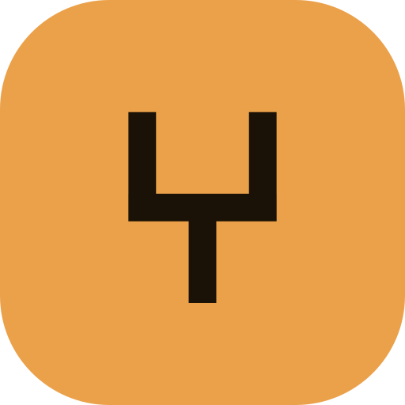

# kosa8 plugin for Claude Code



Give Claude a sealed machine to work in. This plugin connects Claude Code to
[kosa8](https://kosa8.com), secure infrastructure for AI agents: every agent
gets its own sealed machine, a real microVM with its own kernel, not a
container sharing the host's kernel.

With the plugin enabled, Claude can:

- run untrusted or agent-written code in a sealed microVM that sees one folder
  (the workspace) and nothing else on the host;
- work behind a closed network, where only hosts on an allow-list you write are
  reachable and anything else gets a refused connection;
- use API keys without holding them: an egress broker on the host injects them
  on the way out, and the sandbox holds only a placeholder;
- checkpoint the whole running machine, memory and processes, in about 0.7
  seconds before a risky step, and rewind it, still running, in about a second
  when something goes wrong;
- fork a running machine into live copies to try approaches in parallel and
  keep the one that works;
- wait for one or two named human approvers on risky actions (the two-person
  rule), with every action written to a hash-chained, tamper-evident audit log.

The plugin has two parts:

- **An MCP server** (`.mcp.json`) that starts `kosa8 mcp serve`, the kosa8 MCP
  server, as a local stdio process.
- **A skill** (`skills/kosa8-sandbox`) that tells Claude when to reach for a
  sandbox and how to use checkpoints, rewind, fork, egress allow-lists and
  approvals safely.

## Prerequisites

- Claude Code.
- kosa8 installed on the same machine, with `kosa8` on your `PATH`. kosa8 runs
  on Apple-chip Macs and x86-64 Linux, and on Windows through WSL2 (preview).
  Install it with one line:

  ```sh
  curl -fsSL https://kosa8.com/install.sh | sh
  ```

  Releases are signed and notarised. Check the install with `kosa8 version`.

## Install

In Claude Code, add this repository as a marketplace and install the plugin:

```
/plugin marketplace add kosa8ai/kosa8-claude-plugin
/plugin install kosa8@kosa8
```

Or from your shell:

```sh
claude plugin marketplace add kosa8ai/kosa8-claude-plugin
claude plugin install kosa8@kosa8
```

Restart Claude Code (or run `/reload-plugins`). Run `/mcp` to confirm the
`kosa8` server is connected, and ask Claude to "check kosa8 status".

### Sharing host folders

By default, agents cannot share any host directory into a sandbox. To let them
share a project folder, start the server with `--allow-mount DIR` (read-only)
or `--allow-mount DIR:rw`. You can do that by adding your own MCP server entry,
for example in a project's `.mcp.json`:

```json
{
  "mcpServers": {
    "kosa8-workspace": {
      "command": "kosa8",
      "args": ["mcp", "serve", "--allow-mount", "/Users/you/code/api:rw"]
    }
  }
}
```

### Network and keys

Network access for a sandbox is set when it is created. To give a sandbox
access to one API and nothing else, create it from your terminal:

```sh
kosa8 sandbox create sealed --egress-allow api.anthropic.com
```

## Tools

`kosa8 mcp serve` exposes these tools (as reported by `kosa8 mcp tools` in
kosa8 0.5.0):

| Tool | What it does |
| --- | --- |
| `kosa8_status` | Check whether the kosa8 daemon is running and report its version |
| `sandbox_create` | Boot an isolated microVM sandbox with its own kernel and container engine |
| `sandbox_list` | List sandboxes, including which parent each fork came from |
| `sandbox_run` | Run a container inside a sandbox's private engine, isolated from the host |
| `sandbox_pull` | Pull an image into a sandbox's private engine |
| `sandbox_checkpoint` | Save a restore point, including memory and running processes |
| `sandbox_checkpoint_list` | List a sandbox's restore points |
| `sandbox_rewind` | Put a sandbox back to a checkpoint, with processes resumed |
| `sandbox_fork` | Fork a running sandbox into N independent copies |
| `sandbox_explore` | Best-of-N: fork once per candidate command, run them concurrently, keep the winner |
| `sandbox_snapshot` | Capture a sandbox's full state as a snapshot |
| `sandbox_stop` | Stop a sandbox without deleting it |
| `sandbox_start` | Start a stopped sandbox from its own disk |
| `sandbox_delete` | Stop and delete a sandbox and its VM |
| `snapshot_list` | List saved sandbox snapshots |
| `snapshot_restore` | Boot a sandbox from a snapshot, resuming its processes |
| `snapshot_rm` | Delete a snapshot |
| `container_run` | Run a container to completion and return its output |
| `container_exec` | Run a command inside a running container |
| `container_list` | List containers |
| `container_logs` | Fetch a container's output |
| `container_stats` | Report CPU, memory and pid usage for a container |
| `container_stop` | Stop a running container |
| `image_build` | Build an image from a Dockerfile in a host directory |
| `image_list` | List images |
| `image_pull` | Pull an image from a registry |
| `network_create` | Create an isolated bridge network |
| `network_list` | List container networks |
| `volume_create` | Create a named volume |
| `volume_list` | List named volumes |

Run `kosa8 mcp tools` to see the list for your installed version.

## What this plugin runs

The plugin contains no executable code of its own. It runs exactly one
command, `kosa8 mcp serve`, which must already be installed on your machine.
The plugin itself sends no data anywhere and contacts no server. It does not
read any credential from your environment.

## Privacy

The kosa8 MCP server runs locally and talks to the kosa8 daemon on the same
machine. Under the [kosa8 privacy policy](https://kosa8.com/privacy/), the tool
calls your agent makes, their arguments and their results stay on your machine
and never reach kosa8. The policy lists everything the kosa8 software sends and
when, including licence checks for paid licences, and how to turn all outbound
calls off with `KOSA8_OFFLINE=1`.

Full policy: https://kosa8.com/privacy/

## Pricing

kosa8 is commercial software. The plugin files in this repository are free and
MIT licensed, but kosa8 itself needs a licence: it comes with a free 14-day
trial with every feature, no account and no card. Plans start at $29 a month.
See https://kosa8.com/pricing/.

## Support and contact

- Email: contact@kosa8.com
- Issues: https://github.com/kosa8ai/kosa8-claude-plugin/issues
- Website: https://kosa8.com

## License

The files in this repository are released under the [MIT License](LICENSE).
The license covers the plugin files only, not the kosa8 software, which is
distributed separately under its own terms.
